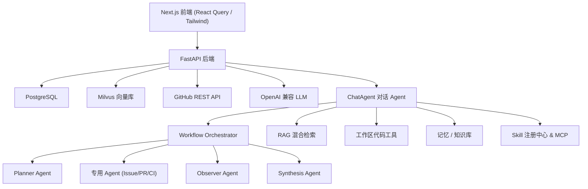
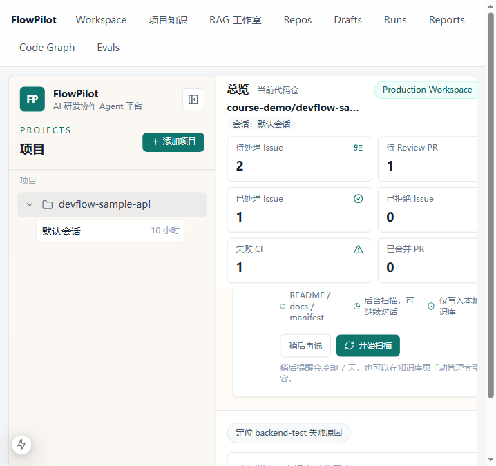
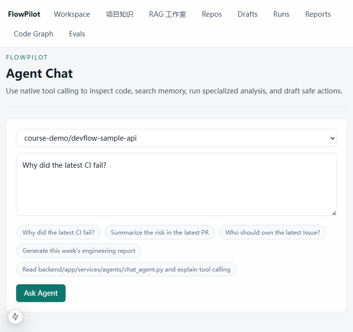
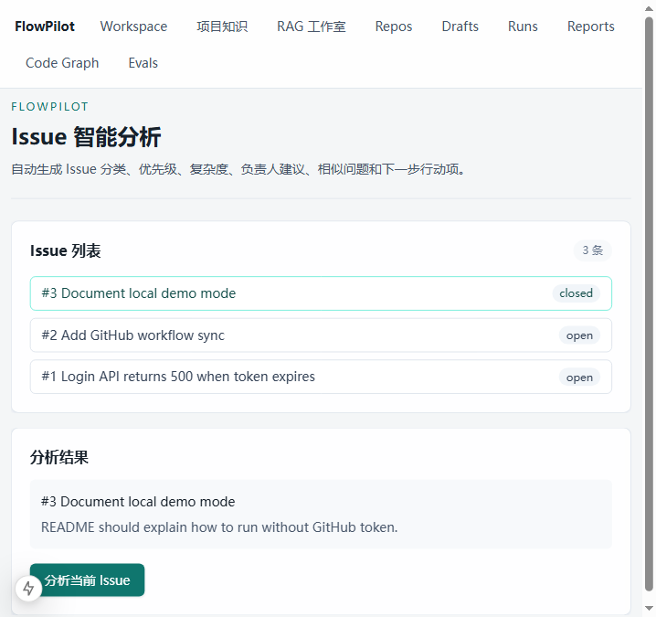
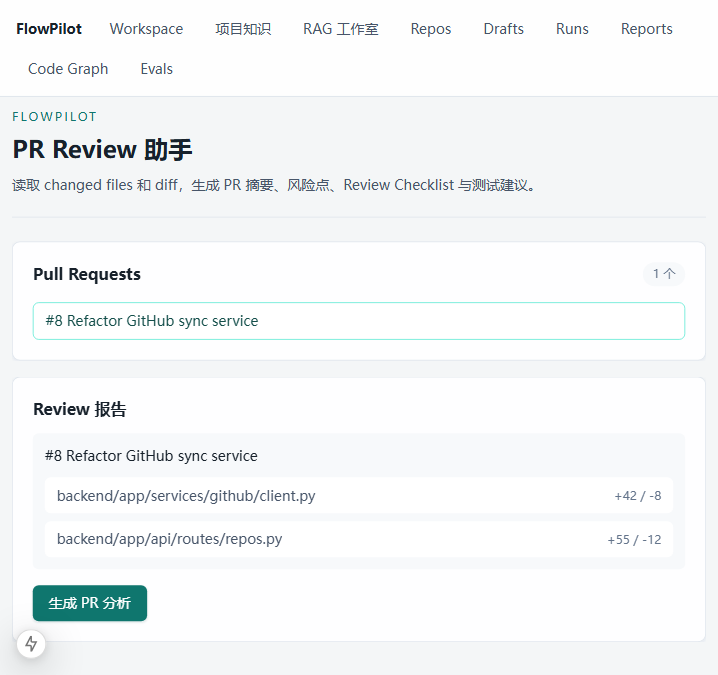
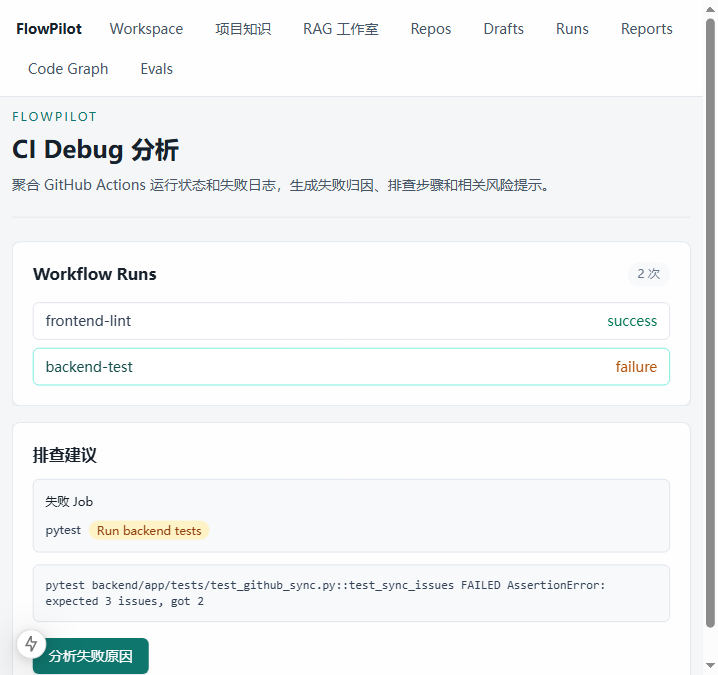
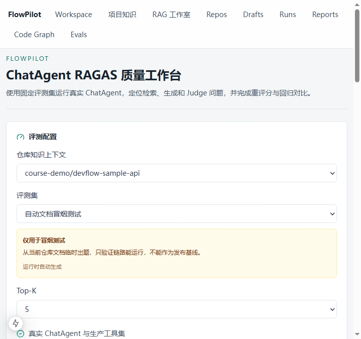

# FlowPilot AI 研发协作 Agent 平台

> 你的 AI 研发领航员 —— 面向 GitHub Issue / PR / CI 全流程的全栈 AI Agent 系统


## 项目简介

FlowPilot 是一个面向真实研发协作场景的全栈 AI Agent 平台。系统连接 GitHub 仓库，自动同步 Issue、Pull Request、CI 日志、项目知识库与本地工作区代码，由具备**原生工具调用（Function Calling）能力**的 Agent 进行分析，并以**安全草稿 + 人工确认**的方式产出可执行的工程操作，避免 AI 直接对外部系统造成副作用。

项目采用前后端分离架构，提供「免依赖 SQLite 演示模式」与「PostgreSQL + Milvus 完整模式」两套运行方式，可在普通笔记本上一键启动。

## 核心功能

### AI Agent 研发协作

- **Issue 智能分析**：自动分类、优先级、复杂度、推荐负责人、重复候选与行动项
- **PR 审查助手**：基于变更文件与 diff 生成摘要、风险点、Review Checklist 与测试建议
- **CI 排障**：聚合 Workflow 运行状态与失败日志，归纳失败类型、可能原因与排查步骤
- **Agent 对话**：`ChatAgent` 通过原生工具调用串联工作区、记忆、RAG、Issue、PR、CI、周报等工具
- **工程周报**：自动汇总周期内的研发活动并生成结构化报告

### 多 Agent 工作流

`WorkflowOrchestrator` 构建 **Planner → 专用 Agent → Observer → Synthesis** 的闭环：先由规划 Agent 拆解任务，再分发给各专用 Agent 并行分析，观察 Agent 负责校验，最终由综合 Agent 汇总，用于 PR 就绪度评估、阻塞项识别与跨领域工程决策。

### RAG 知识问答系统

- 完整 RAG 链路：文档解析 → 段落感知切片 → Embedding → **向量/关键词混合检索** → 重排 → 基于证据生成并附**编号引用**
- 支持 TXT、Markdown、PDF、DOCX、JSON、CSV 与日志文件，按 SHA-256 去重
- 混合检索：进入推理前由 `ContextAssembler` 预注入证据，推理中 Agent 仍可把 `rag.search` 作为工具改写查询、交叉验证
- 数据分级处理：仅对需要语义召回的非结构化知识向量化，源码走工作区检索，实时状态走结构化查询，避免盲目向量化

### 工程质量与安全

- **安全草稿机制**：所有外部写操作先生成可审阅草稿，经具备权限的用户确认后才执行，并写入审计记录
- **RAGAS 质量评测**：在隔离会话中真实运行 ChatAgent，计算 Context Precision / Recall、Faithfulness、Answer Relevancy、Agent Goal Accuracy 五项指标，支持同基线回归对比
- **Skill Runtime**：按显式指定或触发条件按需加载 `SKILL.md`，并将版本、激活原因与执行校验写入 trace
- **MCP 集成**：内置 MCP 服务与客户端，支持可扩展的工具生态

## 系统架构



## 技术栈

| 分层 | 技术 |
| --- | --- |
| 后端 | Python 3.13、FastAPI、Pydantic、SQLAlchemy、httpx、LangChain |
| Agent | 原生 Function Calling、多 Agent 编排、ReAct 工具循环 |
| 前端 | Next.js 15、TypeScript、Tailwind CSS、React Query |
| 数据存储 | PostgreSQL、Milvus（向量）、SQLite（演示） |
| 基础设施 | Docker Compose、WSL2、`.env` 配置 |
| 质量评测 | RAGAS 0.4、pytest、结构化输出校验 |

## 项目结构

```text
DevFlow-AI
├── backend/
│   ├── app/
│   │   ├── api/routes/        # FastAPI 路由（chat/rag/issues/ci/evals 等）
│   │   ├── core/              # 配置与基础组件
│   │   ├── db/                # 数据库模型与会话
│   │   ├── services/
│   │   │   ├── agents/        # ChatAgent 及各专用 Agent、编排器
│   │   │   ├── rag/           # 切片、检索、重排、Embedding
│   │   │   ├── llm/           # LLM 封装与结构化输出
│   │   │   └── evals/         # RAGAS 评测运行器
│   │   ├── mcp/               # MCP 服务
│   │   ├── skills/            # 内置 Skill 定义
│   │   └── tests/             # pytest 测试
│   └── requirements.txt
├── frontend/
│   ├── app/                   # Next.js App Router 页面
│   ├── components/            # UI 组件与布局
│   └── lib/                   # 前端数据请求与工具
├── docs/
│   └── screenshots/           # 项目截图
├── scripts/                   # 一键启动/停止脚本
├── docker-compose.yml
├── .env.example
├── 一键启动.bat / 一键停止.bat
└── 启动说明.md
```

## 快速开始

### 方式一：一键启动（Windows，推荐）

双击项目根目录的 **`一键启动.bat`**，脚本会自动定位运行环境、启动后端与前端、初始化演示数据并打开浏览器。

默认采用 **SQLite 演示模式，无需 Docker**，端口约定：

| 用途 | 地址 |
| --- | --- |
| 前端页面 | http://127.0.0.1:3000 |
| 后端接口 | http://127.0.0.1:8010 |
| API 文档（Swagger） | http://127.0.0.1:8010/docs |
| 健康检查 | http://127.0.0.1:8010/health |

> 后端默认端口为 8010，用于避开本机 Docker 容器可能占用的 8000 端口。命令行启动：`.\scripts\devflow-start.ps1`，停止：`.\scripts\devflow-stop.ps1`。

### 方式二：完整模式（PostgreSQL + Milvus）

```bash
# 1. 准备环境变量
cp .env.example .env

# 2. 启动基础设施（PostgreSQL、etcd、MinIO、Milvus）
docker compose up -d postgres etcd minio milvus

# 3. 启动后端
cd backend
python -m venv .venv
# Windows: .venv\Scripts\activate ; Linux/macOS: source .venv/bin/activate
pip install -r requirements.txt
uvicorn app.main:app --reload

# 4. 另开终端启动前端
cd frontend
npm install
npm run dev
```

## 项目截图

### 工作台总览



### Agent 对话



### Issue 智能分析



### PR Review 助手



### CI 排障分析



### RAGAS 质量评测工作台



## 工程亮点

1. **完整的 Agent 工具调用闭环**：基于原生 Function Calling 实现 ReAct 式推理，Agent 可自主选择并串联十余种工具，支持多轮改写查询与交叉验证。
2. **多 Agent 协同编排**：Planner / 专用 Agent / Observer / Synthesis 分工协作，兼顾分析深度与结论可靠性。
3. **可落地的混合检索 RAG**：向量 + 关键词混合检索叠加重排与证据引用，并对数据按是否需要语义召回进行分级，避免无效向量化。
4. **安全可控的写操作设计**：所有外部操作落为可审阅草稿，经人工确认与审计后才执行，规避 AI 误操作风险。
5. **可量化的质量体系**：用 RAGAS 五指标对 Agent 做自动化评测与回归，把「链路能跑通」和「回答质量达标」明确区分。
6. **双模式可移植**：一套代码同时支持免依赖 SQLite 演示与 PostgreSQL + Milvus 完整部署，普通笔记本即可完整体验。

## API 文档

启动后端后访问 Swagger UI：http://127.0.0.1:8010/docs ，可在线查看并调试全部接口。部分核心模块：

```text
/api/chat          # Agent 对话
/api/rag           # 知识库、检索、问答
/api/issues        # Issue 分析
/api/pull-requests # PR 审查
/api/ci            # CI 排障
/api/evals         # RAGAS 评测
/api/action-drafts # 安全草稿与人工确认
```

## License

本项目仅用于学习与个人作品集展示。
